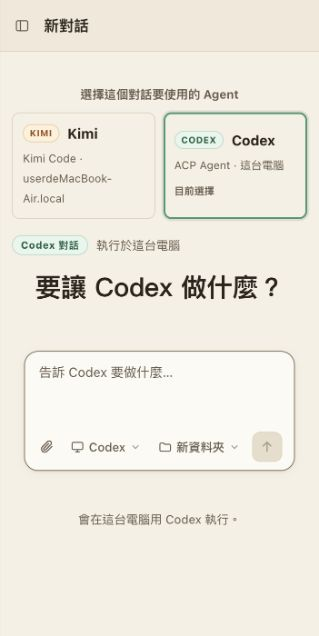
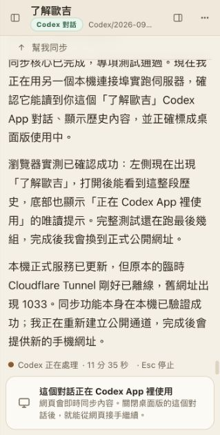

# Agent Hub

把電腦上的 **Kimi Code** 與 **OpenAI Codex** 集中到同一個網頁對話介面。你可以在電腦或手機查看既有對話、傳送新任務、追蹤工具執行與程式修改，也能連接多台電腦，不必一直守在原本的終端機旁。

> 這是自行託管的控制中心。Agent 仍在你的電腦與原本工作目錄執行；瀏覽器負責顯示、同步與下達指令。


## 實際畫面

| 選擇 Kimi 或 Codex | 同步 Codex App 對話 |
| --- | --- |
|  |  |

## 可以做什麼

- **一個入口管理兩種 Agent**：建立新對話時明確選擇 Kimi 或 Codex，側邊欄以不同標籤顯示，避免把工作送錯 Agent。
- **同步現有對話**：讀取本機 Kimi Code 與 Codex App／CLI 的對話紀錄，在手機與電腦延續同一份內容。
- **即時追蹤工作**：串流顯示思考、待辦、讀檔、搜尋、指令、diff、測試結果與權限請求。
- **從網頁操作遠端電腦**：每台電腦透過 bridge 連回 Hub；Agent 仍使用該電腦上的帳號、檔案與工具。
- **Artifact 預覽**：Agent 寫出的 HTML 可以直接在右側面板預覽，修改時同步更新。
- **手機友善**：支援響應式版面與深色模式，離開電腦也能查看進度、回覆或停止工作。
- **工作排程**：支援定時送出、額度恢復後繼續、Kimi 額度自動暫停，以及將等待中的工作移到背景。
- **斷線恢復**：瀏覽器在網路切換、休眠喚醒或暫時出現 524 時會自動重連。

## 運作方式

```text
手機／瀏覽器
      │ HTTPS / WebSocket
      ▼
  Agent Hub
      ├── Kimi bridge ── Kimi Code、既有 session、工作目錄
      └── ACP adapter ── Codex CLI／其他支援 ACP 的 Agent
```

Hub 不會把 Kimi 工作改成 Codex 執行，或把 Codex 工作交給 Kimi。每個對話都保存自己的 Agent 類型與執行位置。

## 系統需求

- Node.js 22 以上
- Git
- 要使用 Kimi：安裝 [Kimi Code](https://github.com/MoonshotAI/kimi-code) 並先執行 `kimi login`
- 要使用 Codex：安裝 Codex CLI 並先執行 `codex login`

## 快速開始

目前 repository 是 Private，第一次 clone 時需要先登入有權限的 GitHub 帳號。

### macOS / Linux

```bash
git clone -b claude/hopeful-newton-kqqnmj https://github.com/zxc7528064/agent-hub.git agent-hub
cd agent-hub
npm run public
```

### Windows PowerShell

```powershell
git clone -b claude/hopeful-newton-kqqnmj https://github.com/zxc7528064/agent-hub.git agent-hub
cd agent-hub
powershell -ExecutionPolicy Bypass -File scripts\start-public.ps1
```

啟動腳本會：

1. 安裝必要的 npm 套件。
2. 在 `127.0.0.1:8787` 啟動 Agent Hub。
3. 建立 Cloudflare Tunnel 公網網址。
4. 產生登入密碼與其他電腦的 bridge 連接指令。
5. 如果本機已安裝 Kimi Code，自動把本機 Kimi 對話接入 Hub。

終端機會印出網址與登入密碼。請把它們視為機密，不要公開貼出。按 `Ctrl+C` 會結束這次 Hub 與 Quick Tunnel。

### 只在本機使用

```bash
npm install
npm start
```

依終端機顯示的網址與 token 開啟網頁；預設監聽 `127.0.0.1:8787`。

## 使用 Kimi

啟動 `npm run public` 後，本機的 Kimi 對話會自動出現在側邊欄。若要讓終端機與網頁同時操作同一個 Kimi，可建立別名：

```bash
echo "alias kimi-hub='node ~/.agent-hub/agent-hub-bridge.mjs kimi'" >> ~/.zshrc
source ~/.zshrc
```

之後用 `kimi-hub` 取代 `kimi` 啟動。沒有透過 `kimi-hub` 或 `kimi web` 開啟的終端機對話仍可同步閱讀，但為避免兩邊同時寫入，網頁可能保持唯讀。

## 使用 Codex

Agent Hub 會同步同一台電腦 `~/.codex` 內的 Codex App／CLI 對話，並以綠色 **CODEX** 標籤顯示。

- 對話仍在 Codex App 使用時，Hub 只同步顯示，避免兩個程式同時寫入。
- 關閉該 Codex 對話後，可由 Hub 透過 ACP 接手並延續原本 thread。
- 新建對話時選擇 **Codex**，工作會交給 Codex ACP adapter，不會使用 Kimi。

## 連接其他電腦

在 Hub 左下角選擇「連接電腦…」，把畫面提供的指令貼到另一台電腦執行。連線後，該電腦的對話與工作目錄會出現在同一個 Hub 中。

每台電腦仍各自保存 Agent 登入資訊；bridge 使用獨立金鑰連線，不需要把 Kimi 或 Codex 的帳號密碼傳給 Hub。

## 自動暫停與排程

- `/autopause 90`：Kimi 的 5 小時額度達 90% 時安排優雅暫停，額度恢復後再繼續。
- `/later 30 繼續`：30 分鐘後送出「繼續」。
- `/later 15:30 繼續`：在指定時間送出訊息。
- `/later reset 繼續`：等額度恢復後送出。
- `/bg`：把 Kimi 正在等待的前景子代理或指令移到背景繼續執行。

這些排程由 Hub 執行；關閉瀏覽器後仍會保留，但 Hub 主程式必須持續運作。

## 安全與資料界線

- Hub 登入 token 與 bridge key 儲存在本機 `data/hub.json`，此檔案已被 Git 忽略。
- 請勿公開分享包含 `#token=...` 的網址、bridge 指令、API key 或登入資料。
- Kimi 憑證留在執行 Kimi 的電腦上；bridge 只會把它用於 Kimi 自己的服務。
- Codex 使用本機既有的 `codex login`／ChatGPT 登入狀態。
- Quick Tunnel 網址適合臨時使用；固定網域部署應搭配 Cloudflare Access 或其他存取控制。

## 更新與驗證

```bash
git pull
npm run check
npm test
```

更新完成後重新啟動 Hub。`npm run check` 會檢查 JavaScript 語法，`npm test` 會執行完整測試套件。

## 支援的擴充方式

除了 Kimi 與 Codex，後端也預留：

- Agent Client Protocol（ACP）Agent
- 一般 CLI Agent
- OpenAI-compatible API
- 本機 Ollama

這些連接器可在設定或後端模板中啟用；使用 API 型連接器時，費用與資料處理由對應供應商決定。

## License

MIT
